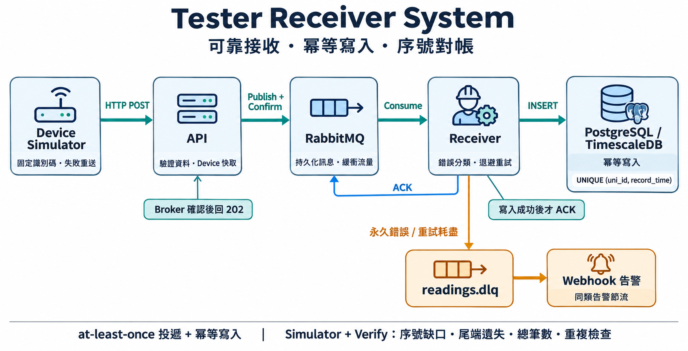

# Tester Receiver System

用 Go 實作的測試機台資料接收服務。主題是**可靠性**：資料不丟、重送不重複，而且「有沒有掉資料」可以被驗證。完整規格見 [SPEC.md](SPEC.md)。

各階段的開發過程、流程、驗證方法與尚未確認的事項見 [docs/DEVELOPMENT.md](docs/DEVELOPMENT.md)。

## 架構



- **API**：驗證 payload、查 device 快取、發佈到 RabbitMQ，等 broker 確認後才回 202。不依賴資料庫。
- **Receiver**：消費訊息、檢查 device、冪等寫入，成功後才 ack。失敗依種類重試或進 DLQ。內建 watchdog。
- **資料保證**：at-least-once 投遞 + 冪等寫入。三段都可能重送，全部由同一個 unique constraint 吸收。

一句話總結：**寧可重複，不可遺失；重複由資料庫擋掉；有沒有遺失可以用序號對帳證明。**

## 進度

| 階段 | 內容 | 狀態 |
|---|---|---|
| 1 | 直接寫 DB 的 API、冪等寫入、查詢、healthz | ✅ 完成（2026-11-15） |
| 2 | 加入 RabbitMQ（publisher confirm、receiver 手動 ack）、device 快取 | ✅ 完成（2026-11-15） |
| 3 | 錯誤分類、退避重試、DLQ、webhook（節流）、panic 攔截、優雅關閉 | ✅ 完成（2026-11-15） |
| 4 | simulator、verify、metrics、watchdog、chaos test | ✅ 完成（2026-11-15） |
| 5 | 設計取捨補完（選配）；device 快取已在階段 2 完成 | ✅ 完成（2026-11-15） |

### 階段 1 驗收結果

| 驗收條件 | 結果 |
|---|---|
| `go vet`、`go test ./...` | 全部通過（model 單元測試、handler 測試、store 整合測試） |
| 同一筆 `uni_id` 送兩次 | 兩次都回 202，資料庫只有 1 筆 |
| 未知 device / 壞 payload / 非 UTC 時間 | 404 / 400 / 400 |
| k6 100 VU 跑 1 分鐘 | 164,394 筆請求、0 錯誤、約 2,738 req/s、p95 42.65 ms；資料庫新增筆數 164,394，完全相符 |
| `docker stop` API | 日誌出現 `api stopped cleanly`，exit code 0 |

### 階段 2 驗收結果

| 情境 | 結果 |
|---|---|
| `go vet`、`go test -race ./...` | 全部通過（含 publisher / consumer 對真實 broker 的整合測試） |
| k6 100 VU 跑 1 分鐘（約 3,731 req/s） | API 接受 223,939 筆、0 錯誤；queue 排空後資料庫 223,939 筆、無重複 |
| receiver 停機期間送 1,500 筆，再啟動 | 停機時 queue 積壓 1,500、資料庫 0 筆；啟動後資料庫 1,500 筆、無重複 |
| 消化 47,201 筆積壓途中對 receiver 送 SIGTERM | 停止當下「已寫入 3,119 + queue 剩餘 44,082」= 47,201；exit code 0；重啟後 47,201 筆，重送造成的重複為 0 |
| broker 停機 | API 回 503、`/healthz` 回 503；broker 啟動後 API 自動重連 |
| broker 重啟（queue 內有 500 筆未消費） | 訊息仍在（durable queue + persistent 訊息），最後資料庫筆數相符 |
| 資料庫停機 12 秒期間持續送 1,200 筆 | API 全部回 202（device 查快取，不依賴資料庫）；receiver 14 秒內只重排 8 次，沒有 hot loop；資料庫恢復後 1,200 筆、無重複 |

觀察：API 每秒可接受約 3,700 筆，但 receiver 預設 4 個 worker 每秒約寫入 700 筆（每筆兩次資料庫往返、各自 commit）。對規格的 100 msg/s 綽綽有餘，突發流量則由 queue 緩衝後慢慢消化——這正是 MQ 的用途。要提高消化速度可調 `WORKERS`，再往上是批次寫入。

### 階段 3 驗收結果

| 情境 | 結果 |
|---|---|
| `go vet`、`go test -race ./...` | 全部通過（錯誤分類、退避、節流、receiver 各種結局都有單元測試） |
| 流量進行中資料庫停機 20 秒（預設 5 次重試只撐約 3 秒） | 送出 3,995 筆、資料庫 3,995 筆、DLQ 0 筆；停機期間只有 29 次重試（沒有 hot loop） |
| 注入 7 筆毒訊息（6 筆格式錯誤、1 筆未知 device），同時有正常流量 | 7 筆全進 `readings.dlq`，header 帶失敗原因、原始 payload 完整保留；正常的 500 筆不受影響 |
| Webhook 節流 | 7 筆失敗只送出 1 則告警 |
| 消化 38,745 筆積壓途中 SIGTERM | 1.2 秒內停止、exit code 0；「已寫入 + queue 剩餘」= 38,745；重啟後筆數相符，重送造成的重複 0 筆 |
| 資料庫停機、worker 正在退避重試時 SIGTERM | 7.2 秒內停止、exit code 0；4 個 worker 手上的訊息都還給 queue；恢復後 600 筆全數寫入 |

驗收中抓到並修正的問題：關閉時 worker 原本會把已預取的 50 筆都處理完才結束，資料庫故障時每筆要等一次逾時，拖過 Docker 的 10 秒寬限而被 SIGKILL（資料沒有遺失，但不是優雅關閉）。現在關閉時只完成處理中的訊息，尚未開始的直接還給 queue。

### 階段 4 驗收結果

| 情境 | 結果 |
|---|---|
| `go vet`、`go test -race ./...` | 全部通過 |
| **Chaos test**（100 台 device、60 秒，期間停 receiver 10 秒、停 postgres 10 秒） | 6,000 筆被接受；無缺口、100 台的最後序號全部相符、6,000 筆、無重複、DLQ 為 0。exit code 0 |
| **Chaos test 完整版**（90 秒，另外重啟 RabbitMQ） | 7,611 筆被接受（simulator 重試了 778 次）；五項檢查全部通過。exit code 0 |
| 反向驗證：對帳前手動刪掉 3 筆 | verify 回報 `device-042#10` 缺口、`device-007` 尾端少 2 筆、總筆數少 3。exit code 1 |
| 穩態（服務未重啟）跑 20 秒，`verify -strict` | 恆等式成立：accepted 2,000 = written 2,000 + duplicate 0 + dlq 0 + queue 0 |
| 注入 consumer 卡住（`FAULT_STALL`） | `/healthz` 仍回 200、資料庫 0 筆；watchdog 發出 `consumer_stuck` 與 `no_writes` 兩則告警。解除故障後 3,000 筆全數補寫 |

Chaos test 的輸出：

```
[t+  7s] fault: stopping receiver for 10s
[t+ 18s] fault: starting receiver
[t+ 26s] fault: stopping postgres for 10s
[t+ 37s] fault: starting postgres
[t+ 60s] simulator finished: accepted=6000 retries=0 rejected=0 unconfirmed=0

[PASS] queue drained          readings ready=0 unacked=0, readings.dlq=0
[PASS] sequence gaps          0 missing
[PASS] last seq per device    100 devices match
[PASS] row count              6000 rows = 6000 accepted by the API
[PASS] duplicates             0 by (uni_id, record_time), 0 by (device_id, seq)
[INFO] counter identity       accepted=6000 ; written=5247 + duplicate=0 + dlq=0 + queue=0 = 5247  → not expected to balance

RESULT: PASSED
```

## 執行方式

對外 port：

| 服務 | 位址 | 備註 |
|---|---|---|
| API | `localhost:8090` | `/v1/readings`、`/healthz`、`/metrics`、`/metrics.json` |
| receiver | `localhost:8091` | `/healthz`、`/metrics`、`/metrics.json` |
| **流程監控頁面** | http://localhost:8095 | 即時的資料流程圖，堵塞與停機會直接顯示在圖上 |
| Grafana | http://localhost:3001 | 免登入可檢視；編輯用 `admin` / `tester` |
| Prometheus | http://localhost:9090 | Alerts 頁面可看告警規則的狀態 |
| RabbitMQ 管理介面 | http://localhost:15673 | `tester` / `tester` |
| Postgres | `localhost:5440` | `tester` / `tester`，資料庫 `tester` |
| RabbitMQ | `localhost:5673` | |

### 流程監控頁面

http://localhost:8095 。一頁看完系統現況，不需要懂 PromQL：

- **在線設備**：近 30 秒內有資料被接受的設備數 / 已註冊的設備數。
- **流量**：每秒進入的筆數，以及每秒寫入資料庫的筆數。兩者差距就是正在堆積的量。
- **錯誤（近 5 分鐘）**：被拒絕（4xx）、未獲 broker 確認（503）、receiver 重試次數、進 DLQ 的筆數。
- **系統狀態**：頁面最上方的標題就是現況，用一句白話寫出來（「資料正常流動」「Queue 堵塞」「資料庫連不上」），下方一行說明原因與影響。
- **架構圖**：一條訊號路徑，設備 → API → Queue → Receiver → 資料庫，節點是線上的圓點。資料點沿線移動，密度隨流量變化。

圖上會出現的變化：

| 情況 | 畫面 |
|---|---|
| 進來的比消化的快 | **資料點在 Queue 裡堆起來**，Queue 轉為琥珀色（積壓）或紅色（堵塞）；出口那一段變慢並標示「消化不及」；上游照常流動 |
| Receiver 停機 | Receiver 打叉，Queue 出口變成紅色虛線「沒人取走」，資料庫變成虛線圓圈（狀態未知） |
| 資料庫連不上 | 資料庫打叉，最後一段變成紅色虛線「寫不進去」且沒有資料點；API 那一段仍正常流動 |
| Broker 斷線 | API 到 Queue 變成紅色虛線「連線中斷」，設備到 API 標示「部分被退回」 |
| 有訊息進 DLQ | DLQ 節點轉為琥珀色並顯示筆數 |
| 監控資料中斷 | 所有節點變成虛線圓圈、沒有任何資料點；標題改為「無法取得監控資料」，不會停在舊數字上假裝正常 |

「堵塞」的判定：Queue 等待中的訊息 ≥ 1,000 筆，或 ≥ 100 筆且仍在增加。≥ 100 筆為「積壓」。

**互動**

- 指向或點選節點，圖下方顯示那一段的細節與近 5 分鐘走勢。點選會固定，再點一次或按「取消固定」解除。
- 系統異常時，會自動顯示出問題那個節點的細節；窄螢幕上還會把圖捲到那個節點。
- 可用鍵盤操作：Tab 在節點間移動，Enter 固定，Esc 取消。
- 支援深色模式；系統設定為「減少動態效果」時不顯示移動的資料點，狀態改由文字與線條樣式表達。

**預覽各種狀態**

不必真的弄壞系統就能看每一種畫面。頁尾的「預覽其他狀態」可以切換，也可以直接用網址：

```
http://localhost:8095/?demo=jam
```

可用的值：`normal`、`idle`、`backlog`、`jam`、`db`、`receiver`、`broker`、`dlq`、`offline`。預覽時右上角會標示「不是即時資料」。

**實作與測試**

頁面由 `cmd/dashboard` 提供：靜態檔案嵌在執行檔裡，資料經由它轉發到 Prometheus 的查詢 API（只開放查詢，不開放管理端點）。沒有前端框架，也沒有建置步驟。資料每 5 秒更新一次，也就是 Prometheus 的抓取間隔。

「量測值 → 畫面該長什麼樣子」的判讀邏輯獨立放在 `cmd/dashboard/web/logic.js`，不碰 DOM，有單元測試：

```bash
node --test cmd/dashboard/webtest/logic.test.mjs
```

### 監控（Prometheus + Grafana）

`docker compose up -d` 會一併啟動。打開 http://localhost:3001 就是儀表板，不用另外設定：資料來源與儀表板都由 `monitoring/` 下的檔案自動載入。

儀表板上有：服務是否存活、queue 深度（等待中 / 處理中 / DLQ）、距離上次寫入多久、API 與 receiver 每秒處理量（依結局分色）、重試次數、延遲的 p50 / p95 / p99、goroutine 數與記憶體。

要看到有意義的圖，跑一次 chaos test 再回來看：receiver 停機時 queue 上升、資料庫停機時出現重試、broker 重啟時出現 `publish_failed`，恢復後 queue 回到 0。

`/metrics` 是 Prometheus 格式；`/metrics.json` 是同一組數值的 JSON，給 verify 與 chaos 對帳用。

### Chaos test

一鍵執行，失敗時 exit code 非 0：

```bash
docker compose --profile tools run --rm chaos
```

完整版（另外重啟 RabbitMQ）：

```bash
docker compose --profile tools run --rm chaos -duration 90s -rabbitmq
```

chaos 容器會掛載 Docker socket 以便停啟其他容器，這等同給它主機的 Docker 控制權，只適合本機測試。有 make 的環境可用 `make chaos`、`make chaos-full`。

### 個別工具

simulator 與 verify 也可以分開跑（報告寫在 `./out/`）：

```bash
docker compose --profile tools run --rm simulator -duration 30s -out /out/report.json
```

```bash
docker compose --profile tools run --rm verify -report /out/report.json
```

`verify -strict` 會把計數器恆等式不成立也算失敗，只適用於 api 與 receiver 啟動後沒有重啟過的情況。

### 驗證 watchdog

讓 worker 拿著訊息不處理，並把檢查間隔調短（PowerShell）：

```powershell
$env:FAULT_STALL='true'; $env:WATCHDOG_INTERVAL='5s'; $env:WATCHDOG_STALE_AFTER='10s'; docker compose up -d receiver
```

送一些流量後看告警：

```bash
docker compose logs webhook-sink
```

測完記得移除這三個環境變數並重新 `docker compose up -d receiver`。

### 一般操作

```bash
docker compose up -d --build
```

```bash
curl -X POST http://localhost:8090/v1/readings -H "Content-Type: application/json" -d '{"uni_id":"3f1c2a52-6f0e-4b7e-9d59-0a4a6c1f2b10","device_id":"device-001","seq":1,"record_time":"2026-11-15T12:00:00Z","freq":1000}'
```

```bash
curl "http://localhost:8090/v1/readings?device_id=device-001&limit=10"
```

測試與壓測（本機沒有 Go 時，`scripts/go.ps1` 會改用 golang 映像檔執行）：

```powershell
.\scripts\go.ps1 test ./...
```

```bash
k6 run loadtest/k6.js
```

重置資料庫（會刪除 volume，下次啟動重跑 migrations）：

```bash
docker compose down -v
```

## 目錄

```
cmd/api/            HTTP 服務：驗證、查 device 快取、發佈到 MQ 並等 confirm
cmd/receiver/       消費 MQ、檢查 device、寫資料庫、成功後才 ack；失敗則重試或進 DLQ
cmd/webhooksink/    開發用的 webhook 接收端（把告警印到 log）
cmd/simulator/      模擬 N 台 device（重試、序號），輸出每台的最後序號
cmd/verify/         對帳工具，失敗時 exit code 非 0
cmd/chaos/          一鍵 chaos test：流量 + 故障注入 + 對帳
cmd/dashboard/      流程監控頁面（靜態頁 + Prometheus 查詢代理）
internal/simulator/ simulator 的邏輯（chaos 也會用到）
internal/verify/    對帳的邏輯（chaos 也會用到）
internal/metrics/   計數器、延遲分布，以 Prometheus 與 JSON 兩種格式輸出
monitoring/         Prometheus 設定與告警規則、Grafana 的資料來源與儀表板
internal/notify/    webhook 告警與節流
internal/config/    環境變數載入
internal/model/     Reading 結構與解析、驗證（api 與 receiver 共用）
internal/mq/        publisher（confirm）、consumer（手動 ack）、斷線重連
internal/devices/   device 名單的記憶體快取
internal/retry/     指數退避 + jitter、可取消的等待、錯誤分類（SQLSTATE）
internal/store/     pgxpool：冪等寫入、查詢、device 檢查
migrations/         schema 與 seed（100 台 device）
loadtest/k6.js      壓測腳本
scripts/go.ps1      go 指令包裝（本機或容器）
```

## 設計取捨

常見問題與對應的章節：

| 問題 | 章節 |
|---|---|
| 為什麼 100 msg/s 還用 MQ？ | [為什麼 100 msg/s 還要用 MQ](#為什麼-100-msgs-還要用-mq) |
| 為什麼是 at-least-once + 冪等，而不是 exactly-once？ | [為什麼是 at-least-once + 冪等](#為什麼是-at-least-once--冪等而不是-exactly-once) |
| 為什麼 202 要等 publisher confirm？ack 為何在寫 DB 之後？ | [等 publisher confirm](#為什麼回-202-之前要等-publisher-confirm)、[ack 的時機](#為什麼-ack-要在寫入資料庫之後) |
| 為什麼區分暫時性與永久性錯誤？jitter 為什麼重要？ | [區分錯誤種類](#為什麼要區分錯誤種類)、[jitter](#為什麼需要-jitter) |
| 如何證明沒有掉資料？尾端遺失如何處理？ | [如何證明沒有掉資料](#如何證明沒有掉資料) |
| Consumer 卡住（活著但不消化）如何被發現？ | [Consumer 卡住如何被發現](#consumer-卡住如何被發現) |
| Hypertable 為什麼 unique constraint 必須含 `record_time`？ | [Hypertable 的 unique constraint](#hypertable-的-unique-constraint-為什麼含-record_time) |
| 若規模變成 100 倍，下一步會改什麼？ | [規模變成 100 倍](#規模變成-100-倍會改什麼) |

### 冪等寫入：`INSERT ... ON CONFLICT DO NOTHING`

Device 收到 5xx 或逾時會重送，而且無法分辨「伺服器沒收到」與「收到了但回應遺失」。所以重送一定會發生，系統必須讓重送無害。做法是由 device 產生 `uni_id`，重送時沿用，資料庫用 unique constraint 擋掉第二筆，再以 `RowsAffected()` 分辨新寫入與重複。

不採用「先 SELECT 再 INSERT」：兩個並行的重送會同時查不到、同時寫入。由 constraint 把關才沒有競態。

### Hypertable 的 unique constraint 為什麼含 `record_time`

TimescaleDB 把 hypertable 依時間切成多個 chunk，每個 chunk 有自己的索引，沒有跨 chunk 的全域索引。只有當 unique 鍵包含分區欄位時，資料庫才能確定「會衝突的兩筆一定落在同一個 chunk」，所以規定必須包含。

代價是冪等鍵變成 `(uni_id, record_time)`。因此規格要求 `record_time` 由 device 產生、重送時不變；API 也強制它必須是 UTC，避免同一時刻有多種寫法。

### 新寫入與重複都回 202

對 device 而言兩者意義相同：這筆不用再送了。如果重複回 409，device 端就要多寫一條分支，而且容易被誤當成錯誤處理。

### 回應碼決定 device 是否重試

- 400 / 404：資料本身有問題，重送也不會成功，不重試。
- 503：伺服器端暫時性問題，device 以相同的 `uni_id` / `seq` / `record_time` 重試。

回給 client 的 503 訊息固定為 `service unavailable`，內部錯誤只寫進日誌。

### 為什麼 100 msg/s 還要用 MQ

不是為了吞吐量。階段 1 直接寫資料庫就有 2,700 req/s。用 MQ 是為了三件事：

- **資料庫故障時不丟資料**：階段 1 資料庫一停 API 就只能回 503，資料保不保得住全看 device 端重試。現在資料庫停機期間 API 照常回 202，訊息留在 queue，恢復後補寫。
- **緩衝突發流量**：API 收得比 receiver 寫得快時，差額堆在 queue 而不是壓垮資料庫。
- **收與寫可以各自擴展、各自部署**：重啟 receiver 不影響收資料。

代價是多一個要維運的元件、多一段會出錯的路徑，以及資料從「收到」到「查得到」之間有延遲（查詢 API 是最終一致）。

### 為什麼回 202 之前要等 publisher confirm

`Publish` 只代表訊息寫進了 TCP socket，不代表 broker 已經收下並寫入磁碟。如果不等 confirm 就回 202，device 會認為送達而不再重試；broker 若在這個空檔掛掉，資料就永久遺失，而且沒有人知道。

等 confirm 之後，責任的交接點很明確：回 202 之前由 device 負責重試，回 202 之後由 broker 保證不丟。

confirm 逾時回 503 時，訊息其實可能已經進了 queue，device 重試會造成重複。這是刻意的選擇——寧可重複（冪等寫入會吸收），不可遺失。這就是 at-least-once。

### 為什麼是 at-least-once + 冪等，而不是 exactly-once

跨網路的 exactly-once 投遞做不到：送出方無法分辨「對方沒收到」與「對方收到了但回覆遺失」。能選的只有 at-most-once（不重試，可能丟）與 at-least-once（重試，可能重複）。選後者，再讓處理端冪等，效果上就等同 exactly-once。

本系統有三段會重送，全部由同一個 unique constraint 吸收：device → API（503 重試）、API → broker（confirm 逾時後 device 重試）、broker → receiver（ack 前斷線則重新投遞）。

### 為什麼 ack 要在寫入資料庫之後

- 先 ack 再寫：ack 後 receiver 掛掉，訊息已從 queue 移除但還沒進資料庫，**遺失**。
- 先寫再 ack：寫入後、ack 前掛掉，broker 重新投遞，資料庫擋掉第二筆，**重複但無害**。

所以關閉 auto-ack。auto-ack 等於「broker 一送出就當作處理完成」，是 at-most-once。

### 單一 publisher goroutine

amqp 的 channel 不是 goroutine-safe，而每個 HTTP 請求各跑在自己的 goroutine。做法是只有一個 goroutine 持有 amqp channel，handler 把發佈請求丟進 Go channel 交給它。

如果這個 goroutine 連 confirm 也一起等，就會變成一次只能處理一筆。所以它只負責「發佈」並把 `DeferredConfirmation` 交還給 handler，由各個 handler 自己等 confirm。發佈是序列的，等待是並行的。

斷線時 `Publish` 立刻回錯誤（不排隊），API 馬上回 503，請求不會堆積在記憶體裡。

### Prefetch 的作用

沒設 prefetch 時，broker 會把整個 queue 的訊息一次推給 consumer，全部堆在 receiver 的記憶體；receiver 一掛，全部要重送。`Qos(50)` 限制「已送出但未 ack」的訊息最多 50 筆，同時也是背壓：receiver 寫不動時，訊息留在 broker 而不是 receiver。

### 優雅關閉的順序

- **API**：先 `http.Server.Shutdown`（等 in-flight 請求），再停 publisher。順序反過來的話，正在等 confirm 的請求會失敗。
- **Receiver**：收到 SIGTERM 後先取消訂閱（broker 不再送新訊息），連線保持開啟讓處理中的訊息 ack 得回去，worker 全部結束後才關連線。已經領到的訊息用不受關閉訊號影響的 context 寫完。

即使優雅關閉失敗（例如被 SIGKILL），未 ack 的訊息也會由 broker 重新投遞，所以優雅關閉是為了減少重送，而不是防止遺失。

### Device 快取：過濾器，不是權威

API 用記憶體中的 device 名單做檢查（每 30 秒從資料庫刷新，失敗就沿用舊的），所以資料庫故障時，已知的 device 仍能送資料。

快取可能過期，兩個方向各有處理：

- **剛註冊的 device 不在快取裡**：這時不直接回 404，而是向資料庫確認一次，存在就加進快取。原因是 404 對 device 的意思是「不要重試」；直接回 404 的話，剛註冊的 device 在快取刷新前送來的資料會被永久丟棄，而且沒有任何告警。
- **確認不了（資料庫剛好故障）**：回 503 讓 device 重試，不回 404。「查不到」和「不存在」是兩回事。
- **不存在的 ID 被拿來狂打**：確認過不存在的 ID 會記住 5 秒，期間不再查資料庫，避免每一筆都穿過快取打到資料庫。
- **剛刪除的 device 還在快取裡**：API 會放行，但寫入時資料庫的 foreign key 會拒絕，訊息進 DLQ（原因 `unknown_device`）。

所以權威是 `readings.device_id` 的 foreign key，而不是另外一次查詢。receiver 原本在寫入前先 SELECT 一次 devices，已經拿掉：檢查與寫入變成同一個動作，不存在「查的時候還在、寫的時候被刪了」的空窗。

### 鍵相同但內容不同

冪等的鍵是 `(uni_id, record_time)`。重送的內容一定和原本完全相同，所以「鍵已存在」原本一律當成重複並略過。

但如果 device 端有 bug，兩筆不同的讀數用了同一個鍵，第二筆也會被當成重複默默略過——它不會進資料庫，也不會進 DLQ，沒有任何紀錄。現在寫入時會一併比對內容：鍵已存在但 `device_id`、`seq` 或 `freq` 不同，就不是重送，而是鍵衝突，訊息進 DLQ（原因 `key_conflict`）。比對和寫入在同一個 SQL 敘述裡完成，沒有多一次往返。

### 為什麼要區分錯誤種類

一律重試：毒訊息（格式錯誤、device 不存在）會永遠重試，佔住 worker，後面的正常訊息被擋住。
一律不重試：資料庫抖一下就把資料丟進 DLQ，要人工處理。

所以分成三類（`internal/retry/classify.go`，依 PostgreSQL 的 SQLSTATE 與錯誤型別判斷）：

| 類別 | 例子 | 處理 |
|---|---|---|
| 永久性 | payload 無法解析、device 不存在、違反 constraint（23xxx）、數值超出範圍（22xxx） | 不重試，直接進 DLQ |
| 暫時性 | deadlock（40P01）、serialization failure（40001）、statement timeout（57014） | 指數退避重試，最多 5 次，用完進 DLQ |
| 資料庫不可用 | 連線被拒、連線中斷（08xxx）、資料庫關機中（57P01）、連線數滿（53300） | 持續退避重試（上限 10 秒一次），不計次數，直到恢復 |

第三類是規格沒有的。規格的預設值是 100ms 起跳、最多 5 次，總共只等約 3 秒；資料庫重啟通常要 10 秒以上，照規格會把所有處理中的訊息都送進 DLQ。但資料庫連不上時問題不在訊息——換哪一筆來都會失敗——所以不該算在單筆訊息的重試次數上。

**逾時的歧義**：資料庫沒回應時，錯誤往往只是「context deadline exceeded」，分不出是這筆查詢太慢還是資料庫掛了。做法是先當成暫時性；重試用完、準備進 DLQ 之前先 `Ping` 一次，Ping 也失敗就改判為資料庫不可用，繼續重試。換句話說，進 DLQ 的條件是「資料庫活著，但這筆訊息就是寫不進去」。

**停機期間的失敗不佔用重試額度**：只要判定為資料庫不可用，這筆訊息的重試次數就歸零。這是後來才補上的。原本沒有歸零，停機期間累積的逾時會把額度用完；資料庫一恢復，「恢復前就發出、正好逾時」的那次寫入失敗時 Ping 已經成功，訊息就被誤判為寫不進去而進了 DLQ。實際發生過：資料庫停機約 60 秒，4 個 worker 手上的訊息各有 1 筆進了 DLQ。先前的 chaos test 只停 10 秒，逾時次數還沒到上限，所以沒有發現；修正後以停機 45 秒重跑，20,000 筆全數寫入、DLQ 為 0。

### 為什麼需要 jitter

指數退避解決「重試太密」，jitter 解決「大家同時重試」。資料庫恢復的瞬間，如果所有 worker 和所有 device 都剛好在同一時刻重試，剛起來的資料庫會被同步的流量再打掛一次（thundering herd）。等待時間取 `[d/2, d]` 的隨機值，把重試打散。保留一半固定等待是為了確保最短間隔，不會抽到接近 0 而變成 hot loop。

### DLQ 的處理順序

進 DLQ 的訊息保留原始 payload，header 記錄 `x-failure-reason`、`x-failure-detail`、`x-attempts`、`x-original-queue`、`x-failed-at`，修好問題後可以原封不動重放。

順序是「發到 DLQ → 等 broker 確認 → ack 原訊息 → 發告警」。如果先 ack 再發 DLQ，中間掛掉訊息就兩邊都不在了。DLQ 發不出去時不 ack，把原訊息放回 queue。

沒有用 RabbitMQ 內建的 dead-letter exchange（`x-dead-letter-exchange`）：它由 broker 轉送，無法附上應用層的失敗原因，也無法在轉送成功後才 ack。

### 攔截 panic

一筆訊息讓 worker panic，如果不攔，整個 receiver 會掛掉；重啟後同一筆訊息重新投遞、再 panic，形成 crash loop，整條 queue 停擺。所以每筆訊息的處理都包在 `recover()` 裡，panic 視同失敗，走 DLQ 流程。

### Webhook 節流

同一種告警一分鐘最多送一次，其餘只累計次數，下次送出時一併回報（`suppressed_since_last`）。資料庫出問題時可能一秒內上千筆失敗，逐筆通知只會讓人把告警靜音。

### 如何證明沒有掉資料

「跑完沒有錯誤日誌」不算證明。做法是讓資料本身可以被對帳：每台 device 的每筆資料帶一個從 1 開始遞增的 `seq`，事後檢查五件事。

| 檢查 | 抓得到什麼 |
|---|---|
| queue 排空、DLQ 為 0 | 還有資料在路上，或有資料被放棄 |
| 序號缺口查詢 | 中間掉了一筆 |
| 每台 device 的 `max(seq)` = simulator 回報的最後序號 | **尾端遺失** |
| 總筆數 = API 接受的筆數 | 以上兩項的交叉確認 |
| `(uni_id, record_time)` 與 `(device_id, seq)` 都沒有重複 | 冪等失效 |

**尾端遺失是缺口查詢的盲點**：如果某台 device 最後 3 筆全掉了，資料庫裡的 `max(seq)` 也跟著少 3，1..max 之間完全沒有缺口。所以需要一個資料庫以外的真相來源——simulator 自己記下每台送到第幾號，再拿來比對。

**simulator 的「最後序號」必須是已確認的**：device 依序送出，前一筆收到 202 才送下一筆，所以回報 `last_seq = 60` 就代表 1 到 60 全部被 API 接受了。模擬結束時若有一筆重試到逾時仍未確認，會記為 `unconfirmed`；它可能其實已經進了系統，所以 verify 對那台 device 容許多出一筆。

**驗證工具本身也要被驗證**：對帳前手動刪掉 3 筆資料，確認 verify 會失敗並指出是哪幾筆。一個永遠回報通過的檢查沒有價值。

規格原本的重複檢查是 `count(*) - count(DISTINCT (uni_id, record_time))`，但這組欄位有 unique constraint，結果恆為 0。另外加驗 `(device_id, seq)`——它沒有 constraint 保護，如果 device 重送時誤換了 `uni_id`，只有這項抓得到。

### 計數器恆等式為什麼在 chaos 下不成立

```
published(confirmed) = written + duplicate + dlq + queue(ready + unacked)
```

穩態下它成立（實測 2,000 = 2,000）。但 chaos test 會讓它失準，原因有兩個：

- **計數器在記憶體裡**，receiver 一重啟就歸零（實測左邊 6,000、右邊 5,247）。
- **重送會重複計數**：寫入後、ack 前掛掉的訊息會被重新投遞並計為 `duplicate`，右邊就比左邊多。

所以 chaos 以資料庫的實際內容為準，恆等式只列出供參考；`verify -strict` 才把它當成硬性檢查。計數器適合回答「這個行程現在健不健康」，不適合當帳本。要讓它跨重啟成立，得把計數持久化，而那等於再做一次資料庫已經在做的事。

### Consumer 卡住如何被發現

`/healthz` 回答的是「行程還在、連線還在」。但 consumer 可能活著卻不做事——例如所有 worker 都在等一個永遠不回應的呼叫。此時行程正常、broker 連線正常、資料庫連線正常，healthz 是綠的，而資料不再進資料庫。

這種故障只能從結果發現。watchdog 每分鐘看三件事：

- `readings.dlq` 深度 > 0
- 等待中的訊息比上一輪多，且這段期間一筆都沒處理完（`consumer_stuck`）
- 超過 2 分鐘沒有成功寫入，而 queue 不是空的（`no_writes`）

後兩項要搭配「queue 非空」或「queue 在成長」：半夜沒流量時很久沒寫入是正常的，不該告警。

「有沒有處理完」用 receiver 自己的計數器判斷，而不是管理 API 的 ack rate：管理 API 的數字約 5 秒才更新一次，而且是整個 queue 的總和。

### 規模變成 100 倍會改什麼

100 倍是 10,000 台 device、每秒 10,000 筆、每天約 8.6 億筆。以下依「會先撞到的瓶頸」排序，數字是本專案在單機 Docker 上的實測值。

**1. Receiver 的寫入方式（最先撞到）**

實測 4 個 worker 每秒約寫入 1,900 筆（同一台機器不同時間量到過 700，波動很大）。每筆訊息各自 commit。

原本每筆訊息還要先 SELECT 一次 devices，後來拿掉了。但前後各量數次，都是約 1,900 筆/秒，**沒有可量測的差別**：瓶頸不在那次查詢。推測是每筆各自 commit 的成本（每次 commit 都要等 WAL 寫入磁碟），這一點沒有另外做實驗確認。所以下一步是批次：

- 批次寫入：一次取一批訊息，用多列 `INSERT ... ON CONFLICT DO NOTHING` 一次寫入、一次 commit，再用 `Ack(multiple=true)` 整批 ack。量更大時改成 `COPY` 到暫存表，再 `INSERT ... SELECT ... ON CONFLICT`（`COPY` 本身不支援 `ON CONFLICT`）。
- 批次的代價是失敗處理變複雜：一批裡有一筆壞掉會讓整批失敗，要能退回逐筆處理，把壞的那筆挑出來送 DLQ。

**2. Receiver 的數量**

多開幾個 receiver 消費同一個 queue（competing consumers）即可，不需要改程式。前提是訊息處理不依賴順序——本系統成立，因為寫入是冪等的，`seq` 只用於事後對帳而不是用來排序寫入。

**3. Broker 的可用性**

目前是單節點，broker 的磁碟壞掉就會遺失尚未消費的訊息，這是現行架構最大的單點故障。

- 改用 quorum queue（三節點、Raft 複寫），代價是 confirm 延遲變長、吞吐量下降。
- 加上 queue 長度上限，超過時讓 API 回 503 把壓力推回 device，而不是讓 broker 的磁碟被塞滿。
- 如果之後需要「重放過去某段時間的資料」或「多個下游各自消費」，才值得換成 Kafka 這類 log 型系統。單純的工作佇列用 RabbitMQ 比較簡單。

**4. API**

實測單一實例每秒接受約 3,700 筆。API 是無狀態的（device 快取每個實例各自一份），前面放負載平衡器水平擴展即可。單一 publisher goroutine 會是單實例內的瓶頸，可改成數個 publisher 各持有一條 amqp channel。

**5. 資料庫**

- unique index 的鍵是隨機的 UUID，每次 INSERT 都落在索引的隨機位置，資料量大了之後會是寫入的主要成本。改用時間有序的 UUIDv7，新資料就集中在索引尾端。
- TimescaleDB：調整 chunk 的時間區間讓「正在寫入的 chunk 與其索引」放得進記憶體、對舊 chunk 啟用壓縮、設定資料保留期限。
- 查詢走 read replica，常用的彙總用 continuous aggregate 預先算好。

**6. 可觀測性**

Prometheus 與 Grafana 已經加入（見下方「為什麼加入 Prometheus 與 Grafana」）。規模變大後還需要補的是：接上 Alertmanager 讓告警能主動通知並分級、加上 PostgreSQL 的指標（連線數、寫入延遲、chunk 大小）、以及跨服務的追蹤（trace），才能回答「這一筆資料從 API 到寫入資料庫，時間花在哪一段」。

**不會改的部分**：at-least-once + 冪等寫入、等 confirm 才回 202、寫入後才 ack、錯誤分類與 DLQ、序號對帳。這些是正確性的設計，與規模無關。

### 為什麼 device 快取用 map 而不是 bloom filter

規格提到可以用 bloom filter 做前置過濾。沒有採用，因為在這個規模它只有缺點：

- bloom filter 的價值是「用很少的記憶體表示很大的集合」。100 台 device 的 map 只佔幾 KB，一萬台也不到 1 MB，沒有記憶體問題要解。
- bloom filter 有 false positive（不存在的 device 被判定為存在），而且不支援刪除。map 是精確的。

要到集合大到放不進記憶體（上億筆）時 bloom filter 才划算。不論用哪一種，它都只是過濾器，receiver 端的資料庫檢查才是權威。

### Device 端離線補傳的設計（未實作）

以上的保證都從「API 回了 202」開始。在那之前——網路斷線、API 長時間不可用——資料能不能保住取決於 device 端。規格把這段列為非目標，只描述設計：

**即時路徑的保護：`unsend_log`**

Device 產生每筆資料時，先寫進本機的 `unsend_log` 檔案，再嘗試送出；收到 202 才把它從檔案中標記為已送達。斷電重開機後，從檔案讀出未送達的資料繼續重送，沿用原本的 `uni_id` / `seq` / `record_time`。這和 API 端「等 confirm 才回 202」是同一個原則：在對方確認接手之前，自己要留著一份。

**第二條獨立的路徑：午夜整檔上傳**

每天午夜，device 把當天全部的資料（不論即時路徑是否送達）整檔上傳到 NAS / FTP。後端的批次匯入程式讀檔，用同樣的 `INSERT ... ON CONFLICT DO NOTHING` 寫入。

- 因為冪等鍵相同，即時路徑已經寫入的資料會被擋掉，只有遺漏的會補進去。兩條路徑可以放心重疊。
- 這是一條與 HTTP、MQ 完全無關的路徑。即時路徑有任何沒被發現的遺失，隔天都會被補齊。
- 匯入後可以跑同樣的序號缺口查詢：匯入前後的差異，就是即時路徑實際掉了多少資料——這是衡量即時路徑可靠度最直接的指標。

代價是資料最長會延遲一天才完整，而且需要管理檔案的保留與重複上傳。

### 為什麼加入 Prometheus 與 Grafana

原本的 `/metrics` 只有累計的計數器，能回答「到現在為止寫入了幾筆」，但回答不了三件事：

- **趨勢**：queue 是在變長還是變短？計數器只有當下的值，沒有歷史。
- **延遲的分布**：平均值會把問題蓋掉。99% 的請求 5 毫秒、1% 的請求 5 秒，平均起來看不出異常。所以用 histogram 記錄，查詢時取 p50 / p95 / p99。
- **receiver 整個掛掉**：watchdog 跑在 receiver 行程裡，receiver 死了它也跟著消失。Prometheus 在外面抓指標，抓不到就是 `up == 0`。實測停掉 receiver 後 40 秒 `ReceiverDown` 告警觸發，重啟後解除。

**計數器不會有兩份帳。** Prometheus 的計數器是用 `CounterFunc` 包裝原本的 atomic 值，抓取時才去讀。所以 Prometheus、`/metrics.json`、watchdog 看到的是同一個數字。

**重啟歸零的問題在這裡不存在。** 計數器重啟會歸零，這讓恆等式在 chaos 下不成立。但 Prometheus 的 `rate()` 會偵測到數值變小並當成重置處理，所以「每秒幾筆」的圖不受重啟影響。這是把計數器交給時序資料庫的主要好處：行程不必自己記住歷史。

**Queue 深度不經過應用程式。** RabbitMQ 內建 Prometheus 外掛，直接抓它的 `/metrics/detailed`。receiver 掛掉時 queue 深度仍然看得到。

**告警規則與 watchdog 的分工：**

| | watchdog | Prometheus 告警規則 |
|---|---|---|
| 位置 | receiver 行程內 | 外部 |
| receiver 掛掉時 | 跟著消失 | 仍在運作（`ReceiverDown`） |
| 主動通知 | 有（webhook） | 沒有——未接 Alertmanager，只能在 Prometheus 的 Alerts 頁面看到 |
| 需要額外的服務 | 不需要 | 需要 Prometheus |

兩者目前是互補的。接上 Alertmanager 之後，watchdog 的三項檢查都可以由告警規則取代。

### 已知限制

- Prometheus 的告警規則沒有接 Alertmanager，不會主動通知。
- `increase()` 算出的筆數是估計值（它會外插到查詢視窗的邊界），chaos 期間實測比實際多約 2%。**對帳要用 verify，不能用 Prometheus 的數字。**
- 沒有 PostgreSQL 的指標。
- watchdog 跑在 receiver 行程內。receiver 整個掛掉時它也跟著消失，那種情況要靠外部監控（容器重啟策略、對 `/healthz` 的探測）。
- 資料庫長時間停機時，worker 會一直持有未 ack 的訊息。RabbitMQ 預設在訊息未 ack 超過 30 分鐘時關閉該 channel（`consumer_timeout`），屆時 consumer 會自動重連、訊息重新投遞，不會遺失，但會多一次重送。
- DLQ 的訊息目前要透過 RabbitMQ 管理介面手動檢視與重放，沒有重放工具。
- 資料庫不可用時每個 worker 各自退避重試，沒有共用的 circuit breaker。4 個 worker 的規模下沒有問題。

### 與規格的差異

| 項目 | 規格 | 實作 | 原因 |
|---|---|---|---|
| 重試耗盡 | 一律 5 次後進 DLQ | 資料庫不可用時持續重試；單筆暫時性錯誤才受次數限制 | 預設重試總長約 3 秒，但 chaos test 會停資料庫 10 秒，照規格必定進 DLQ |
| 優雅關閉 | 等處理中的訊息完成 | 同規格；已預取但尚未開始的訊息直接還給 queue | 資料庫故障時把 50 筆預取都做完會拖過容器的停止寬限 |
| Receiver 的處理順序 | 解析 → 檢查 device 存在 → 寫 DB | 解析 → 寫 DB，device 由 foreign key 檢查 | 檢查與寫入合成一個動作，沒有兩者之間的空窗，也少一次往返 |
| 未知 device 的回應 | 404 | 資料庫確認不存在才回 404；無法確認時回 503 | 404 會讓 device 不再重試。快取沒命中不等於不存在 |
| 重複的判定 | `ON CONFLICT` 未新增即為重複 | 另外比對內容，內容不同視為鍵衝突並進 DLQ | 否則鍵相同但內容不同的資料會被默默丟棄 |
| 計數器恆等式 | chaos 後必須成立 | 穩態測試驗嚴格等式；chaos 以資料庫筆數為準 | 計數器在記憶體，receiver 重啟會歸零；重送會讓 `duplicate` 多算 |
| 重複檢查 | `count(DISTINCT (uni_id, record_time))` | 另加驗 `(device_id, seq)` | 前者被 unique constraint 保證恆為 0，驗不出問題 |
| Device 快取 | 階段 5 選配 | 提前到階段 2 | 否則資料庫故障時 API 無法收資料 |
| `make chaos` | Makefile 一鍵執行 | chaos 流程寫成 Go 程式並以容器執行，Makefile 只是包裝 | Windows 沒有 make；容器化後不需要在主機安裝 Go |
| 計數器 | 規格列的 5 個 | receiver 多一個 `requeued` | 讓 `received = written + duplicate + dlq + requeued` 對得起來 |
| Go 版本 | 1.22+ | 1.26 | `go mod tidy` 依相依套件（Prometheus client 等）的需求自動設定 |
| Prometheus 與監控堆疊 | 列為非目標 | 已加入 Prometheus 與 Grafana | 後續追加的需求；記憶體計數器只能看「現在是多少」，看不到趨勢與延遲分布 |
| `/metrics` 的格式 | expvar 或純文字 | `/metrics` 為 Prometheus 格式，`/metrics.json` 為 JSON | Prometheus 預設抓 `/metrics`；對帳工具讀 JSON 比較簡單 |
